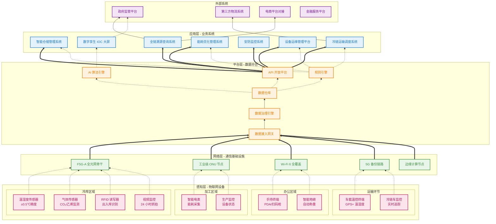

# 嵩明高原特色农副产品智慧冷链产业园
## 数字化系统架构图 (中文版本)

---

## 📊 架构说明

### **1. 感知层（数据采集）**
- **覆盖范围**：冷库、加工区、运输车辆、办公区
- **核心设备**：温湿度传感器、RFID、视频监控、智能电表
- **技术指标**：温度精度±0.5℃，采集频率 1-5 分钟/次

### **2. 网络层（数据传输）**
- **骨干网**：F5G-A 全光网，时延≤1ms，万兆带宽
- **无线覆盖**：Wi-Fi 6 + 5G 备份，移动设备无缝切换
- **边缘计算**：本地数据处理，降低云端负载

### **3. 平台层（数据中枢）**
- **数据接入**：多协议适配（Modbus、MQTT、HTTP）
- **数据治理**：清洗、转换、标准化、质量管控
- **数据仓库**：存储 3-5 年历史数据（溯源要求）
- **AI 引擎**：温控预测、路径优化、异常检测
- **API 开放**：对接政府监管、第三方系统

### **4. 应用层（业务赋能）**
| 系统 | 核心价值 |
|------|----------|
| **智能仓储** | 出入库效率提升 50%，库存准确率 99%+ |
| **冷链运输** | 在途温控 100% 覆盖，路径优化节省 15% 油耗 |
| **全链溯源** | 一物一码，扫码查产地、温控、检测报告 |
| **能耗管理** | 制冷优化，能耗降低 15-20% |
| **安防监控** | 视频联动、入侵报警、消防联动 |
| **运维管理** | 设备台账、巡检计划、故障工单自动派单 |
| **IOC 大屏** | 3D 数字孪生，全局可视、智能告警、调度指挥 |

### **5. 外部系统对接**
- **政府监管**：农产品质量追溯平台、食品安全监管
- **第三方物流**：订单对接、运力调度、在途跟踪
- **电商平台**：订单数据同步、溯源信息展示
- **金融服务**：供应链金融、库存质押、保险对接

---

## 🔑 关键技术亮点

1. **F5G-A 全光网**：抗干扰、低时延，适应冷库低温高湿环境
2. **数字孪生**：3D 可视化 + 实时数据，园区"一张图"管理
3. **全链溯源**：从田间到餐桌，100% 数据可追溯
4. **AI 预测**：基于历史数据的温控预测、需求预测、故障预测
5. **边缘计算**：本地实时响应，降低云端延迟和带宽成本

---

🐉 **架构图已生成**，你可以：
- 直接复制到支持 Mermaid 的 Markdown 编辑器（如 Typora、VS Code）
- 截图插入 PPT 或方案文档
- 需要我调整细节或生成高清图片吗？
